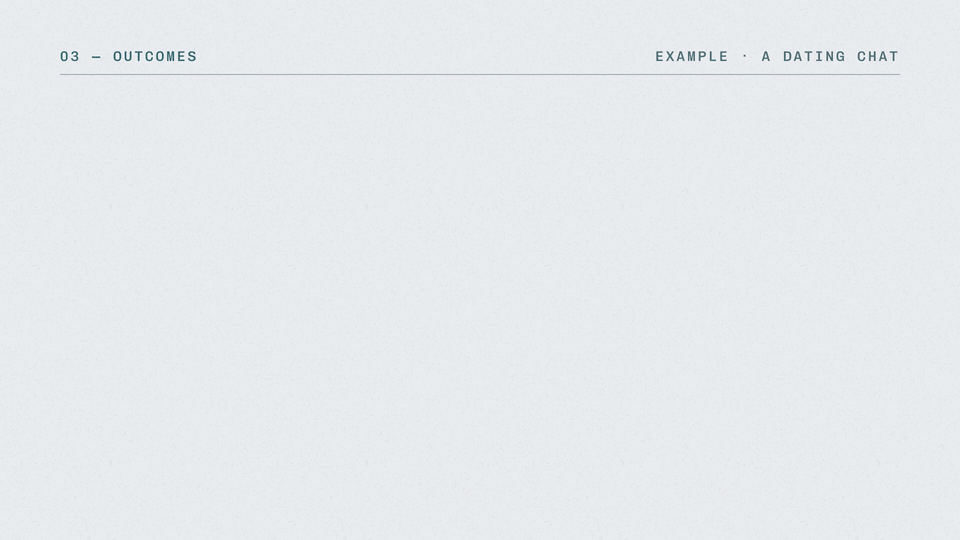

<p align="center">
  
</p>

<p align="center">
  <a href="docs/install.md"><b>Install guide</b></a> ·
  <a href="docs/reference.md">Reference</a> ·
  <a href="docs/recipes.md">Recipes</a> ·
  <a href="#docs">All docs</a>
</p>

# chaperone-chat

An anonymous chat that keeps contact details out. Two or more people talk through signed links and see only each
other's aliases. Every message passes deterministic rules, then TypeSafe's Jev, before anyone else sees it.

Use it where a conversation should stay on your platform until something is agreed: a buyer and a seller before
the sale, two matches before both say yes, a recruiter and a candidate before the interview, a renter and a
landlord before the viewing.

```bash
npm install chaperone-chat
```

## 01 · The rules


Email addresses, phone numbers, links, handles, street addresses, the names of apps to move to, and asks like "text
me". The rules read digits spelled out as words and letters spaced apart, in English and Spanish. A hit is refused
at once, with a sentence that says why, and is never stored.

## 02 · Jev


What the rules pass, Jev reads with the conversation before it. Under 0.20 the message is sent. From 0.20 it's
refused, and the sender can ask for a check. From 0.50 it's refused. When Jev can't answer, the message waits for a
later check. The scores above are real: `jev-1.13.0` on the labelled corpus that ships in `corpus/`.

## 03 · Outcomes



You name the ways a conversation can end: one vote (`sold`, by the seller) or a double opt-in (`swap`, by
everyone). At its deadline it closes as `expired`. Your `beforeClose` hook runs first, to mark the item sold, share
the two people's details or book the interview.

## Try it

```js
// try.mjs
import { createChat, memoryStore } from "chaperone-chat";

const chat = createChat({
  secret: crypto.randomUUID() + crypto.randomUUID(), // signs the links: use a fixed secret of your own in production
  store: memoryStore(),
  jev: false, // the rules alone; pass { apiKey } to add Jev
});

const { links } = await chat.open({
  participants: [
    { role: "buyer", alias: "Sam" },
    { role: "seller", alias: "Alex" },
  ],
});
const sam = links[0].participantId;

for (const text of [
  "Is the bike still for sale?",
  "Text me on 312 555 0142",
  "my number is three one two five five five zero one four two",
  "Let's move this to WhatsApp",
  "Can we meet at the shop on Saturday?",
]) {
  const result = await chat.send(sam, text);
  console.log(result.ok ? `sent     ${text}` : `refused  ${text}  (${result.message})`);
}
```

```text
$ node try.mjs
sent     Is the bike still for sale?
refused  Text me on 312 555 0142  (That looks like a phone number.)
refused  my number is three one two five five five zero one four two  (That looks like a phone number.)
refused  Let's move this to WhatsApp  (That names an app or site for talking or paying outside this chat.)
sent     Can we meet at the shop on Saturday?
```

## Put it in your app

Three files in Next.js:

```ts
// lib/chat.ts
import { createChat } from "chaperone-chat";
import { postgresStore } from "chaperone-chat/postgres";
import pg from "pg";

const pool = new pg.Pool({ connectionString: process.env.DATABASE_URL });

export const chat = createChat({
  secret: process.env.CHAT_LINK_SECRET!, // 32 characters or more
  store: postgresStore((text, params) => pool.query(text, params)),
  jev: { apiKey: process.env.TYPESAFE_API_KEY! },
});
```

```ts
// app/api/chat/route.ts
import { createChatHandler } from "chaperone-chat/http";
import { chat } from "../../../lib/chat";

export const POST = createChatHandler(chat);
```

```tsx
// app/chat/page.tsx
"use client";
import { ChatThread } from "chaperone-chat/react";
import "chaperone-chat/react/styles.css";

export default function ChatPage() {
  return <ChatThread endpoint="/api/chat" />;
}
```

Then create the tables, open conversations, run the sweep and add moderation: the
**[install guide](docs/install.md)** walks through every step.

## In the box

- **A React component**, `<ChatThread>`, themed with CSS variables, light and dark. A framework-free client too.
- **One route.** A Web-standard `(Request) => Promise<Response>` handler for Node, Bun, Deno and edge workers.
- **Postgres** over any driver, memory for tests, or a store of your own.
- **A moderation queue** for held messages: approve, refuse, hide, retry.
- **Notices** for new messages, reminders and closes, handed to your own mailer.
- **The screen on its own** (`chaperone-chat/guard`) for profiles, listings and forms.
- **No runtime dependencies.** Node 22 or later, ESM or CommonJS, typed.

## Jev

Jev is a hosted decision model made by [TypeSafe](https://typesafe.ai). You use it with your own TypeSafe account
and API key, or set `jev: false` and the rules work alone. Jev is sent the new message and up to eight earlier
ones, never an id, an alias or your context: [what is sent to Jev](docs/jev-data.md).

chaperone-chat is an independent open-source project. It is not affiliated with, sponsored by or endorsed by
TypeSafe. Jev is TypeSafe's product: you use it with your own account and under their terms.

## Docs

- [Install guide](docs/install.md): from `npm install` to a working chat
- [Reference](docs/reference.md): every entry point, option and default
- [Recipes](docs/recipes.md): a marketplace, dating, recruiting and peer support
- [Configuration](docs/configuration.md): every option by area, with examples
- [Calibration](docs/calibration.md): how the cutoffs were set, and how to calibrate a policy of your own
- [Security model](docs/security.md): links, auth, what is stored, and what it doesn't protect against
- [What is sent to Jev](docs/jev-data.md): the exact request, and what never leaves your server
- [Storage](docs/storage.md): the memory and Postgres stores, drivers, the schema, and writing your own
- [Notifications](docs/notifications.md): notices, the sweep, and wording them
- [Moderation](docs/moderation.md): the held queue, approve, refuse, hide and retry, and events
- [Limits](docs/limits.md): what the tests prove, and what isn't in this version

[Contributing](CONTRIBUTING.md) · [Security policy](SECURITY.md) · [Changelog](CHANGELOG.md)

## License

MIT © 2026 Hypno Labs LLC. See [LICENSE](LICENSE).
